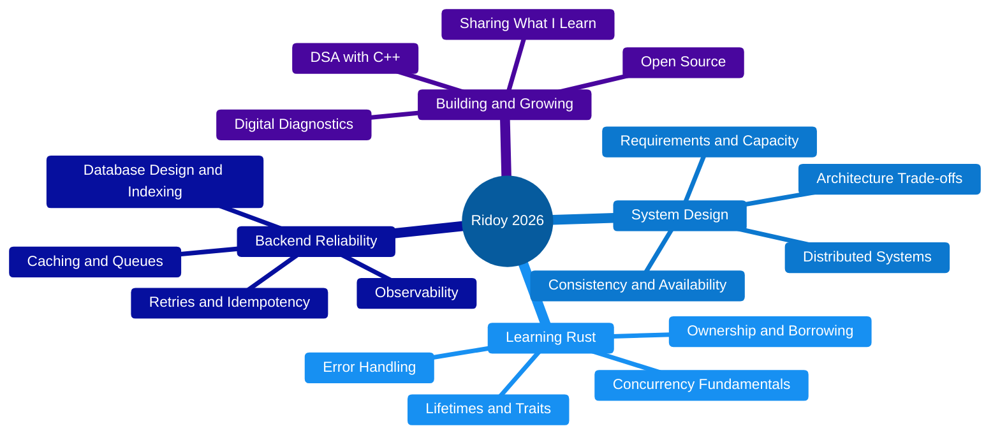

<h1 align="center">
  
</h1>

<p align="center">
<a href="https://nodeninja.netlify.app"></a>
<a href="https://linkedin.com/in/dev-mehedi-hasan-ridoy"></a>
<a href="https://discordapp.com/users/1068481777418649650"></a>
<a href="mailto:devmehedihasan7@gmail.com"></a>
</p>

<p align="center">
  <strong>Backend-focused full-stack developer building useful products and deepening my understanding of system design.</strong><br/>
  <sub>Currently learning Rust 🦀 · Based in Dhaka, Bangladesh · Open to freelance, full-time, and collaborative opportunities</sub>
</p>

<p align="center">
  <a href="#about-me">About</a> •
  <a href="#tech-stack">Tech Stack</a> •
  <a href="#featured-projects">Projects</a> •
  <a href="#github-statistics">Statistics</a> •
  <a href="#current-focus">Current Focus</a> •
  <a href="#contact">Contact</a>
</p>

<div align="center">
  
</div>

---
<a id="about-me"></a>
<h2>
  <table align="left">
    <tr>
      <td></td>
      <td><span style="font-size: 24px;">About Me</span></td>
    </tr>
  </table>
</h2>
<br clear="left"/>


```javascript
const ridoy = {
  pronouns: "He/Him",
  location: "Dhaka, Bangladesh 🇧🇩",
  education: "BSc in Physics 🔬",
  role: "Backend-Focused Full Stack Developer",

  passions: [
    "Understanding system design trade-offs",
    "Crafting reliable APIs and data models",
    "Solving complex problems with code"
  ],

  superpower: "Physics logic + Clean code = 🔥",

  currentlyWorking: "Digital Diagnostics System",
  currentFocus: "System Design & Backend Engineering",
  currentlyLearning: [
    "Rust 🦀",
    "Distributed Systems",
    "Database Design & Caching",
    "Observability & Reliability"
  ],

  availableFor: ["Freelance", "Full-time", "Collaboration"],
  funFact: "I debug code like solving physics equations!"
};
```

<br clear="both"/>

---
<a id="tech-stack"></a>
<h1>
  <table align="left">
    <tr>
      <td></td>
      <td><span style="font-size: 24px;">Tech Stack & Tools</span></td>
    </tr>
  </table>
</h1>
<br clear="left"/>

<div align="center">
<table>
<tr>
<td width="50%" align="center">

####  Backend & Server

<p align="center">
  <a href="https://nodejs.org"></a>
  <a href="https://expressjs.com"></a>
  <a href="https://nestjs.com"></a>
  <a href="https://www.typescriptlang.org"></a>
  <a href="https://www.prisma.io"></a>
</p>

```yaml
Expertise:
  - RESTful API Design
  - GraphQL Implementation
  - Authentication & Authorization
  - API Structure & Validation
```

</td>
<td width="50%" align="center">

####  Database & Caching

<p align="center">
  <a href="https://www.postgresql.org"></a>
  <a href="https://www.mongodb.com"></a>
  <a href="https://redis.io"></a>
  <a href="https://www.prisma.io"></a>
</p>

```yaml
Expertise:
  - Database Schema Design
  - Query Optimization
  - Data Modeling
  - Caching Strategies
```

</td>
</tr>
<tr>
<td width="50%" align="center">

####  Frontend & UI

<p align="center">
  <a href="https://react.dev"></a>
  <a href="https://nextjs.org"></a>
  <a href="https://redux.js.org"></a>
  <a href="https://tailwindcss.com"></a>
  <a href="https://developer.mozilla.org/en-US/docs/Web/JavaScript"></a>
</p>

```yaml
Expertise:
  - Component Architecture
  - State Management
  - Responsive Design
  - Modern UI/UX Patterns
```

</td>
<td width="50%" align="center">

####  DevOps & Tools

<p align="center">
  <a href="https://www.docker.com"></a>
  <a href="https://kubernetes.io"></a>
  <a href="https://www.linux.org"></a>
  <a href="https://git-scm.com"></a>
  <a href="https://github.com"></a>
  <a href="https://github.com/features/actions"></a>
  <a href="https://firebase.google.com"></a>
  <a href="https://www.postman.com"></a>
</p>

```yaml
Tools & Practices:
  - Containerization
  - CI/CD Pipelines
  - Linux & Deployment
  - Version Control
  - API Testing
```

</td>
</tr>
<tr>
<td colspan="2" align="center">

####  Programming & Problem Solving

<p align="center">
  <a href="https://en.cppreference.com/w/c"></a>
  <a href="https://isocpp.org"></a>
</p>

```yaml
Focus:
  - C Programming
  - C++ Programming
  - Data Structures & Algorithms with C++
  - Competitive Problem Solving
```

</td>
</tr>
<tr>
<td colspan="2" align="center">

####  Currently Learning & Exploring

<p align="center">
  <a href="https://www.rust-lang.org"></a>
</p>

```yaml
Focus Areas:
  - Rust Ownership, Borrowing & Lifetimes
  - Traits, Error Handling & Concurrency
  - System Design & Architectural Trade-offs
  - Distributed Systems & Consistency
  - Queues, Caching & Failure Recovery
  - Observability & Performance
```

</td>
</tr>
</table>
</div>

---
<a id="featured-projects"></a>
<h2>
  <table align="left">
    <tr>
      <td></td>
      <td><span style="font-size: 24px;">Featured Projects</span></td>
    </tr>
  </table>
</h2>
<br clear="left"/>

<div align="center">
<table>
<tr>
<td width="50%">

###  Digital Wallet System
[](https://github.com/nodeNINJAr/Digital-Wallet-System-frontend/tree/development)
[](https://degital-wallet.netlify.app/)

Modern digital wallet with real-time transaction workflows.

**Built with:**
- React 19 + TypeScript
- Redux Toolkit + RTK Query
- TailwindCSS + Framer Motion
- React Hook Form + Zod
- Radix UI + Lucide Icons

</td>
<td width="50%">

###  Nexus Tech
[](https://github.com/nodeNINJAr/nexus-tech-client)
[](https://nexustech-b3673.web.app)

Enterprise HR and employee management platform for modern teams.

**Built with:**
- React + Express.js
- MongoDB + Firebase
- Material UI

</td>
</tr>
<tr>
<td width="50%">

###  SayEasy
[](https://github.com/nodeNINJAr/sayEasy-client)
[](https://sayeasy-95352.web.app)

Global language tutoring marketplace with a real-time booking experience.

**Built with:**
- React + Express.js
- MongoDB + Firebase
- Real-time booking system

</td>
<td width="50%">

###  Digital Diagnostics


Comprehensive patient and diagnostic management platform.

**Built with:**
- Node.js + TypeScript
- PostgreSQL + Prisma
- Next.js + TailwindCSS

</td>
</tr>
</table>
</div>

---
<a id="github-statistics"></a>
<h2>
  <table align="left">
    <tr>
      <td></td>
      <td><span style="font-size: 24px;">GitHub Statistics</span></td>
    </tr>
  </table>
</h2>
<br clear="left"/>

<div align="center">
  
</div>
<div align="center">
  
  
</div>

---
<h2>
  <table align="left">
    <tr>
      <td></td>
      <td><span style="font-size: 24px;">Contribution Graph</span></td>
    </tr>
  </table>
</h2>
<br clear="left"/>

<div align="center">
  
</div>

---
<h2>
  <table align="left">
    <tr>
      <td></td>
      <td><span style="font-size: 24px;">What I Bring to the Table</span></td>
    </tr>
  </table>
</h2>
<br clear="left"/>

<div align="center">

|  Backend Engineering |  Database Design |  API Development |
|:---:|:---:|:---:|
| Structured services & business logic | Data models & query optimization | RESTful & GraphQL |
| ** Authentication** | ** Containerization** | ** Modern UI/UX** |
| JWT, OAuth, Sessions | Docker deployments | React ecosystems |

</div>

---
<a id="current-focus"></a>
<h2>
  <table align="left">
    <tr>
      <td></td>
      <td><span style="font-size: 24px;">Current Focus</span></td>
    </tr>
  </table>
</h2>
<br clear="left"/>

<div align="center">



</div>

---
<h2>
  <table align="left">
    <tr>
      <td></td>
      <td><span style="font-size: 24px;">Quick Facts</span></td>
    </tr>
  </table>
</h2>
<br clear="left"/>

<p>
 Physics grad who fell in love with code<br>
 Backend enthusiast with full-stack capabilities<br>
 Exploring system design, reliability, and architectural trade-offs<br>
 Currently learning Rust 🦀<br>
 Coffee-powered developer<br>
 Open to exciting opportunities
</p>

---
<a id="contact"></a>
<h2 align="center">
  <table align="center">
    <tr>
      <td></td>
      <td><span style="font-size: 24px;">Let's Connect & Collaborate!</span></td>
    </tr>
  </table>
</h2>
<br clear="left"/>

<div align="center">

I'm always excited to work on interesting projects and connect with fellow developers!

<a href="https://nodeninja.netlify.app"></a>
<a href="https://linkedin.com/in/dev-mehedi-hasan-ridoy"></a>
<a href="https://discordapp.com/users/1068481777418649650"></a>
<a href="mailto:devmehedihasan7@gmail.com"></a>

<h3 align="center">
  <table align="center">
    <tr>
      <td></td>
      <td><span style="font-size: 24px;">Available For</span></td>
    </tr>
  </table>
</h3>
<br clear="left"/>

✅ **Freelance Projects** • ✅ **Full-time Roles** • ✅ **Open Source** • ✅ **Mentorship** • ✅ **Tech Talks**


</div>

---

<div align="center">

<h3 align="center">
  <table align="center">
    <tr>
      <td></td>
      <td><span style="font-size: 24px;">Words I Live By</span></td>
    </tr>
  </table>
</h3>
<br clear="left"/>

> *"The best way to predict the future is to create it."* — Peter Drucker


**⭐ From [nodeNINJAr](https://github.com/nodeNINJAr) • Made with ❤️ and lots of ☕**

</div>
