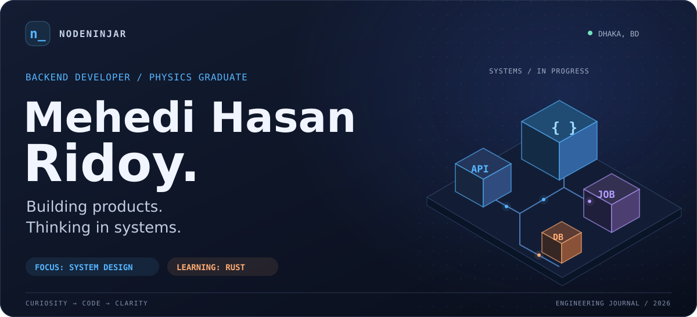
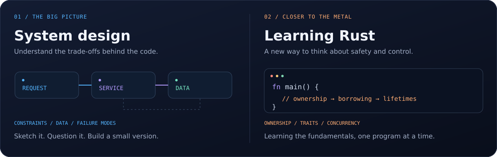
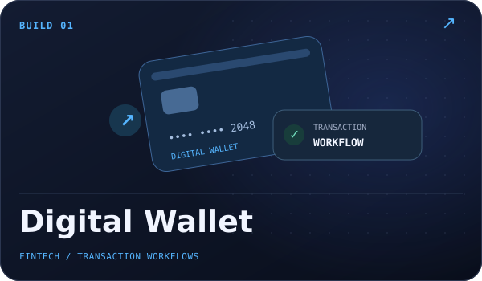
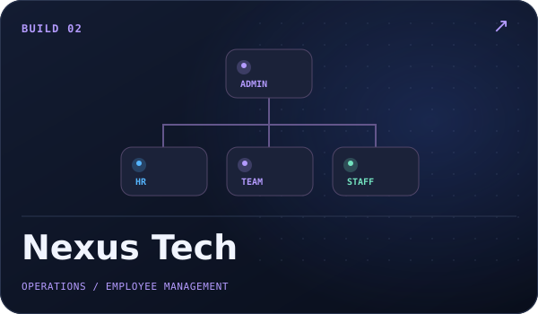
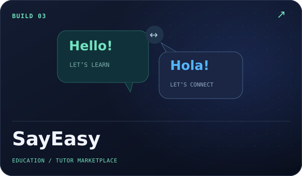
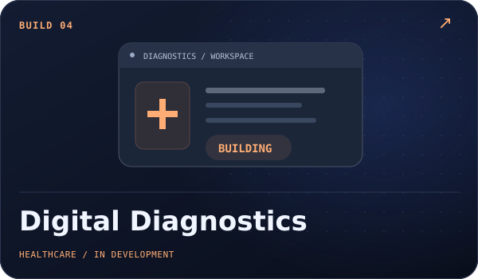

<div align="center">



<br/>


**Backend-focused full-stack developer · Dhaka, Bangladesh**<br/>
<sub>Open to freelance, full-time, and collaborative opportunities</sub>

<br/>

<a href="https://nodeninja.netlify.app"></a>
<a href="https://linkedin.com/in/dev-mehedi-hasan-ridoy"></a>
<a href="https://discordapp.com/users/1068481777418649650"></a>
<a href="mailto:devmehedihasan7@gmail.com"></a>

<br/><br/>

[About](#about-me) &nbsp; · &nbsp; [Current focus](#current-focus) &nbsp; · &nbsp; [Projects](#featured-projects) &nbsp; · &nbsp; [Toolbox](#tech-stack) &nbsp; · &nbsp; [Activity](#github-statistics) &nbsp; · &nbsp; [Contact](#contact)

<br/>



</div>

<br/>

<a id="about-me"></a>
## 👨‍💻 A little about the engineer


I'm **Ridoy**, a physics graduate who found his way into software through curiosity and problem solving.

I enjoy building APIs, modeling data, and connecting the pieces that make a product work. These days, I'm spending more time on the questions behind the code: **What are the constraints? Where will this fail? Which trade-off makes sense?**

```typescript
const ridoy = {
  building: "Digital Diagnostics System",
  focusedOn: "System Design",
  learning: "Rust 🦀",
  approach: "Understand → Build → Measure → Refine",
  poweredBy: ["Physics", "Curiosity", "Coffee"],
};
```

<br clear="both"/>

<a id="current-focus"></a>
## 🧭 The next layer: systems & Rust

<table>
<tr>
<td width="50%" valign="top">

### 🏗️ System design
**Learning to reason about the whole system.**

- Requirements, constraints & capacity estimates
- Service boundaries & API contracts
- Data modeling, indexes & caching
- Queues, retries & idempotency
- Consistency, availability & failure recovery
- Observability & performance bottlenecks

</td>
<td width="50%" valign="top">

### 🦀 Learning Rust
**Building a stronger understanding of how code works.**

- Ownership, borrowing & lifetimes
- Structs, enums & pattern matching
- Traits, generics & composition
- `Option`, `Result` & error handling
- Concurrency & async fundamentals
- Small programs to put the concepts into practice

</td>
</tr>
</table>

> **My study loop:** choose a problem → sketch a design → build a small version → examine the trade-offs.

<a id="featured-projects"></a>
## 🚀 Selected builds

<table>
<tr>
<td width="50%" valign="top">

<a href="https://github.com/nodeNINJAr/Digital-Wallet-System-frontend/tree/development"></a>

A digital wallet interface for managing transaction workflows, with typed forms and application state.

<sub>React Hook Form · Zod · Tailwind CSS · Framer Motion</sub>

**[Explore code ↗](https://github.com/nodeNINJAr/Digital-Wallet-System-frontend/tree/development)** &nbsp; · &nbsp; **[Live demo ↗](https://degital-wallet.netlify.app/)**

</td>
<td width="50%" valign="top">

<a href="https://github.com/nodeNINJAr/nexus-tech-client"></a>

An employee management platform covering employee records, roles, and HR workflows.

<sub>React · Express.js · MongoDB · Firebase · Material UI</sub>

**[Frontend ↗](https://github.com/nodeNINJAr/nexus-tech-client)** &nbsp; · &nbsp; **[Backend ↗](https://github.com/nodeNINJAr/nexus-tech-server)** &nbsp; · &nbsp; **[Demo ↗](https://nexustech-b3673.web.app)**

</td>
</tr>
<tr>
<td width="50%" valign="top">

<a href="https://github.com/nodeNINJAr/sayEasy-client"></a>

A language tutoring marketplace connecting learners with tutors through booking workflows.

<sub>React · Express.js · MongoDB · Firebase</sub>

**[Frontend ↗](https://github.com/nodeNINJAr/sayEasy-client)** &nbsp; · &nbsp; **[Backend ↗](https://github.com/nodeNINJAr/sayEasy-server)** &nbsp; · &nbsp; **[Demo ↗](https://sayeasy-95352.web.app)**

</td>
<td width="50%" valign="top">



A patient and diagnostic management platform. My current build, bringing backend and frontend workflows together.

<sub>Node.js · TypeScript · PostgreSQL · Prisma · Next.js · Tailwind CSS</sub>


</td>
</tr>
</table>

<a id="tech-stack"></a>
## 🛠️ The toolbox

<table>
<tr>
<td width="50%" align="center" valign="top">

### ⚙️ Backend & APIs


<sub>REST · GraphQL · Authentication · Authorization</sub>

</td>
<td width="50%" align="center" valign="top">

### 🗄️ Data & caching


<sub>Schema design · Data modeling · Indexes · Caching</sub>

</td>
</tr>
<tr>
<td width="50%" align="center" valign="top">

### 🎨 Frontend & interfaces


<sub>Components · State management · Responsive UI</sub>

</td>
<td width="50%" align="center" valign="top">

### 🐳 Delivery & tools


<sub>Containers · CI/CD · Deployment · API testing</sub>

</td>
</tr>
<tr>
<td colspan="2" align="center">

### 🧠 Fundamentals & exploration


<sub>C / C++ · Data structures & algorithms &nbsp; | &nbsp; 🦀 Rust — currently learning</sub>

</td>
</tr>
</table>

<a id="github-statistics"></a>
## 📈 Building in public

<div align="center">


<details>
<summary><b>↗ Explore the contribution graph</b></summary>
<br/>

</details>

</div>

<br/>

<a id="contact"></a>
## 🤝 Let's build something useful

<div align="center">

**Have a backend challenge, a product idea, or a system design discussion?**<br/>
I'd love to connect.

<br/>

<a href="mailto:devmehedihasan7@gmail.com"></a>
<a href="https://linkedin.com/in/dev-mehedi-hasan-ridoy"></a>
<a href="https://discordapp.com/users/1068481777418649650"></a>

<br/><br/>

**Freelance** &nbsp; / &nbsp; **Full-time** &nbsp; / &nbsp; **Collaboration**

<br/>


*Understand the fundamentals. Make the trade-offs explicit. Keep building.*


<sub>Made with curiosity, code, and ☕ · <a href="https://github.com/nodeNINJAr">@nodeNINJAr</a></sub>

</div>
